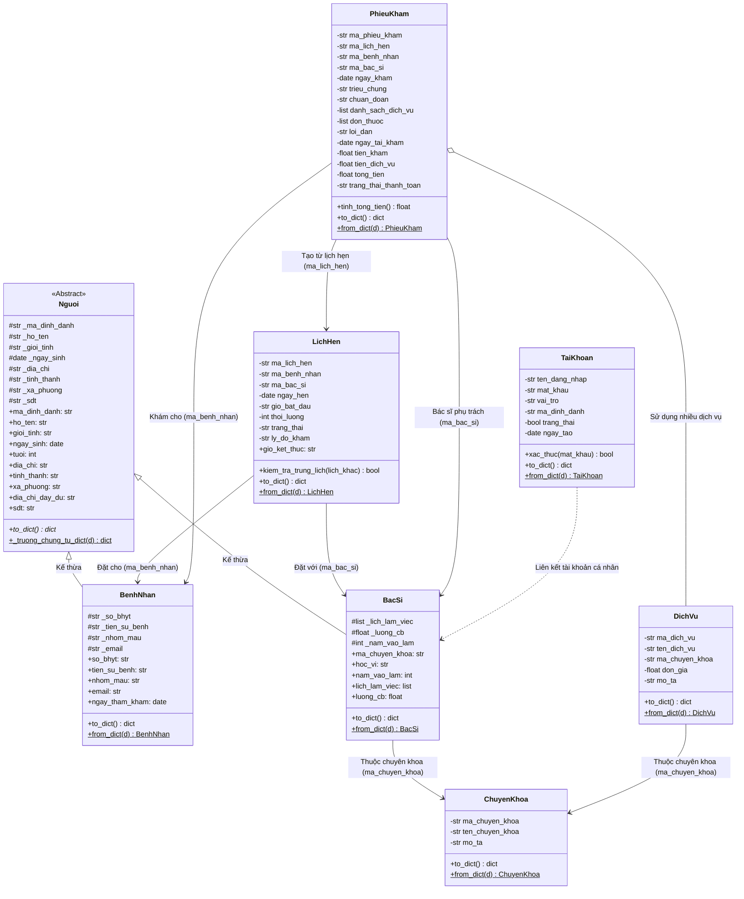

# TÀI LIỆU THIẾT KẾ LỚP VÀ CHUẨN DỮ LIỆU JSON (CLASS DESIGN & JSON SCHEMA)

> **Dự án**: Phần mềm Quản lý Lịch hẹn Phòng khám (Clinic Appointment Management System)  
> **Công nghệ**: Python 3.10+, Tkinter / ttk, OOP (Lập trình hướng đối tượng), Lưu trữ JSON  
> **Thành viên nhóm**: Nhóm 3 người  
> **Tài liệu mục tiêu**: Chốt thuộc tính, kiểu dữ liệu từng lớp và JSON schema lưu trữ dữ liệu.

---

## 1. TỔNG QUAN KIẾN TRÚC HỆ THỐNG

Dự án áp dụng mô hình kiến trúc phân tầng (Layered Architecture):

```
+-------------------------------------------------------------+
|                     VIEWS (Giao diện Tkinter)               |
|  DangNhapView | MainWindow | TabBenhNhan | TabLichHen | ... |
+-------------------------------------------------------------+
                              |
                              v
+-------------------------------------------------------------+
|                   SERVICES (Tầng Xử lý Nghiệp vụ)           |
|  QuanLyTaiKhoan | QuanLyBenhNhan | QuanLyBacSi | ...        |
+-------------------------------------------------------------+
                              |
                              v
+-------------------------------------------------------------+
|                      MODELS (Tầng Thực thể OOP)             |
|  Nguoi (ABC) -> BenhNhan, BacSi | ChuyenKhoa | LichHen | ...|
+-------------------------------------------------------------+
                              |
                              v
+-------------------------------------------------------------+
|               JSON STORE (Lưu trữ và Truy xuất File)        |
|  data/*.json (benh_nhan, bac_si, lich_hen, phieu_kham, ...) |
+-------------------------------------------------------------+
```

- **Tính kế thừa & Trừu tượng**: `Nguoi` là lớp cơ sở trừu tượng (`ABC`), hai lớp `BenhNhan` và `BacSi` kế thừa và mở rộng.
- **Tính đóng gói**: Các thuộc tính cốt lõi được bảo vệ (`_attribute`), truy xuất và kiểm tra tính hợp lệ thông qua các `@property` và `@setter`.
- **Tuần tự hóa dữ liệu**: Mọi lớp Model đều cài đặt hai phương thức chuẩn:
  - `to_dict(self) -> dict`: Chuyển đối tượng thành kiểu từ điển chuẩn bị ghi ra JSON.
  - `from_dict(cls, d: dict)`: Khởi tạo lại đối tượng từ dữ liệu từ điển đọc từ JSON.

---

## 2. SƠ ĐỒ QUAN HỆ LỚP (CLASS DIAGRAM)



---

## 3. ĐẶC TẢ CHI TIẾT THUỘC TÍNH VÀ KIỂU DỮ LIỆU CÁC LỚP MODEL

### 3.1. Lớp Trừu tượng `Nguoi` (`models/nguoi.py`)
Lớp trừu tượng định nghĩa các thông tin cơ bản của một con người trong hệ thống phòng khám.

| Thuộc tính nội bộ | Property | Kiểu Python | Kiểu JSON | Ràng buộc / Validation | Mô tả |
| :--- | :--- | :--- | :--- | :--- | :--- |
| `_ma_dinh_danh` | `ma_dinh_danh` | `str` | `string` | Bắt buộc, duy nhất, không rỗng | Mã định danh duy nhất của cá nhân |
| `_ho_ten` | `ho_ten` | `str` | `string` | Không được rỗng sau khi `strip()` | Họ và tên đầy đủ |
| `_gioi_tinh` | `gioi_tinh` | `str` | `string` | Giá trị: `"Nam"` hoặc `"Nữ"` | Giới tính |
| `_ngay_sinh` | `ngay_sinh` | `date` | `string` (`YYYY-MM-DD`) | Hợp lệ, không lớn hơn ngày hiện tại | Ngày tháng năm sinh |
| `_dia_chi` | `dia_chi` | `str` | `string` | Chuỗi văn bản tự do | Địa chỉ số nhà, tên đường |
| `_tinh_thanh` | `tinh_thanh` | `str` | `string` | Không được để trống | Tỉnh hoặc Thành phố trực thuộc TW |
| `_xa_phuong` | `xa_phuong` | `str` | `string` | Không được để trống | Phường, Xã hoặc Thị trấn |
| `_sdt` | `sdt` | `str` | `string` | `isdigit()` và độ dài đúng 10 số | Số điện thoại liên lạc |

**Thuộc tính tính toán (Read-only Computed Properties):**
- `tuoi -> int`: Tính toán từ `_ngay_sinh` so với `date.today()`.
- `dia_chi_day_du -> str`: Ghép chuỗi `f"{_dia_chi}, {_xa_phuong}, {_tinh_thanh}"`.

**Phương thức:**
- `to_dict(self) -> dict`: *(Abstract method)* Tuần tự hóa các trường chung.
- `_truong_chung_tu_dict(d: dict) -> dict`: *(Static method)* Chuyển từ điển JSON thành tham số khởi tạo (chuyển đổi chuỗi ISO sang kiểu `date`).

---

### 3.2. Lớp `BenhNhan` (`models/benh_nhan.py`)
Kế thừa từ `Nguoi`, quản lý thông tin hành chính và hồ sơ y tế cơ bản của bệnh nhân.

| Thuộc tính | Kiểu Python | Kiểu JSON | Ràng buộc / Validation | Mô tả |
| :--- | :--- | :--- | :--- | :--- |
| *Thuộc tính kế thừa* | Xem lớp `Nguoi` | - | - | Các thuộc tính kế thừa từ `Nguoi` |
| `_so_bhyt` | `str` | `string` | Mặc định `"Không có"` nếu để trống | Số thẻ bảo hiểm y tế |
| `_tien_su_benh` | `str` | `string` | Chuỗi mô tả (VD: "Dị ứng phấn hoa") | Tiền sử bệnh án, dị ứng thuốc |
| `_nhom_mau` | `str` | `string` | Một trong: `"A"`, `"B"`, `"AB"`, `"O"`, `"Chưa rõ"` | Nhóm máu bệnh nhân |
| `_email` | `str` | `string` | Validate Regex email hợp lệ (hoặc rỗng) | Địa chỉ email để nhận thông báo |

**Quy chuẩn Mã bệnh nhân (`ma_dinh_danh`):**
- Định dạng: Chuỗi đúng 14 chữ số (`re.fullmatch(r"\d{14}", ma)`).
- 8 chữ số đầu tiên: Ngày khám đầu tiên dạng `DDMMYYYY` (được kiểm tra hợp lệ bằng `datetime.strptime`).
- 6 chữ số sau: Số thứ tự tiếp nhận bệnh nhân.
- Thuộc tính tính toán: `ngay_tham_kham -> date` (tự động giải mã từ 8 chữ số đầu).

**Phương thức:**
- `to_dict(self) -> dict`: Trả về dict kết hợp trường của `Nguoi` và các trường bệnh nhân + `ngay_tham_kham`.
- `from_dict(cls, d: dict) -> BenhNhan`: Tạo đối tượng `BenhNhan` từ dữ liệu dict.

---

### 3.3. Lớp `BacSi` (`models/bac_si.py`)
Kế thừa từ `Nguoi`, lưu trữ thông tin đội ngũ bác sĩ, chuyên khoa, học vị và chế độ công tác.

| Thuộc tính | Kiểu Python | Kiểu JSON | Ràng buộc / Validation | Mô tả |
| :--- | :--- | :--- | :--- | :--- |
| *Thuộc tính kế thừa* | Xem lớp `Nguoi` | - | - | Các thuộc tính kế thừa từ `Nguoi` |
| `_lich_lam_viec` | `list[str]` | `array[string]` | Danh sách các ca/buổi làm việc | Lịch trực (VD: `["T2-Sang", "T4-Chieu"]`) |
| `_luong_cb` | `float` | `number` | Giá trị $\ge 0$ | Mức lương cơ bản (VND) |
| `_nam_vao_lam` | `int` | `integer` | $1900 \le \text{năm} \le \text{năm hiện tại}$ | Năm bắt đầu công tác |

**Quy chuẩn Mã bác sĩ (`ma_dinh_danh`):**
- Định dạng: Đúng 9 chữ số (`re.fullmatch(r"\d{9}", ma)`).
  - Vị trí `0:2` (2 số đầu): Mã học vị (Tra cứu từ `config.hoc_vi`: `"01"` -> `"TS"`, `"02"` -> `"ThS"`, `"03"` -> `"BS"`).
  - Vị trí `2:4` (2 số tiếp theo): Mã chuyên khoa (`ma_chuyen_khoa`).
  - Vị trí `4:6` (2 số tiếp theo): 2 số cuối của năm vào làm (suy ra năm 4 chữ số thông qua `nam_tu_ma_bac_si`).
  - Vị trí `6:9` (3 số cuối): Số thứ tự bác sĩ trong năm tuyển dụng.

**Thuộc tính tính toán (Read-only Properties):**
- `ma_chuyen_khoa -> str`: Trích xuất `ma_dinh_danh[2:4]`.
- `hoc_vi -> str`: Tra cứu tên học vị theo `config.hoc_vi`.
- `nam_vao_lam -> int`: Được kiểm tra khớp tuyệt đối với 2 chữ số năm trong mã bác sĩ.

**Phương thức:**
- `to_dict(self) -> dict`
- `from_dict(cls, d: dict) -> BacSi`

---

### 3.4. Lớp `ChuyenKhoa` (`models/chuyen_khoa.py`)
Đại diện cho các phòng chuyên khoa y tế trong phòng khám.

| Thuộc tính | Kiểu Python | Kiểu JSON | Ràng buộc / Validation | Mô tả |
| :--- | :--- | :--- | :--- | :--- |
| `ma_chuyen_khoa` | `str` | `string` | Đúng 2 chữ số (VD: `"01"`, `"02"`), duy nhất | Mã chuyên khoa định danh |
| `ten_chuyen_khoa` | `str` | `string` | Không được rỗng (VD: "Nội khoa", "Nhi khoa") | Tên gọi chuyên khoa |
| `mo_ta` | `str` | `string` | Chuỗi văn bản | Mô tả chức năng và phạm vi khám |

**Phương thức:**
- `to_dict(self) -> dict`
- `from_dict(cls, d: dict) -> ChuyenKhoa`

---

### 3.5. Lớp `DichVu` (`models/dich_vu.py`)
Đại diện cho các dịch vụ y tế, xét nghiệm, chẩn đoán hình ảnh và thủ thuật.

| Thuộc tính | Kiểu Python | Kiểu JSON | Ràng buộc / Validation | Mô tả |
| :--- | :--- | :--- | :--- | :--- |
| `ma_dich_vu` | `str` | `string` | Bắt đầu bằng `"DV"`, VD: `"DV001"`, duy nhất | Mã dịch vụ khám bệnh |
| `ten_dich_vu` | `str` | `string` | Không được rỗng | Tên dịch vụ (VD: "Siêu âm bụng tổng quát") |
| `ma_chuyen_khoa` | `str` | `string` | Khóa ngoại tham chiếu `ChuyenKhoa` | Chuyên khoa cung cấp dịch vụ |
| `don_gia` | `float` | `number` | Giá trị $\ge 0$ | Giá tiền dịch vụ (VND) |
| `mo_ta` | `str` | `string` | Chuỗi văn bản | Ghi chú yêu cầu chuẩn bị, vật tư |

**Phương thức:**
- `to_dict(self) -> dict`
- `from_dict(cls, d: dict) -> DichVu`

---

### 3.6. Lớp `LichHen` (`models/lich_hen.py`)
Đại diện cho lịch hẹn đặt trước của bệnh nhân với bác sĩ (gắn liền với giao diện Tab Lịch hẹn và Thẻ lịch hẹn).

| Thuộc tính | Kiểu Python | Kiểu JSON | Ràng buộc / Validation | Mô tả |
| :--- | :--- | :--- | :--- | :--- |
| `ma_lich_hen` | `str` | `string` | Bắt đầu bằng `"LH"`, VD: `"LH001"`, duy nhất | Mã lịch hẹn khám |
| `ma_benh_nhan` | `str` | `string` | Khóa ngoại tham chiếu `BenhNhan.ma_dinh_danh` | Bệnh nhân đăng ký hẹn |
| `ma_bac_si` | `str` | `string` | Khóa ngoại tham chiếu `BacSi.ma_dinh_danh` | Bác sĩ phụ trách khám |
| `ngay_hen` | `date` | `string` (`YYYY-MM-DD`) | Ngày $\ge$ ngày tạo lịch | Ngày dự kiến đến khám |
| `gio_bat_dau` | `str` | `string` (`HH:MM`) | Định dạng 24h, từ 07:00 đến 18:00 | Giờ bắt đầu ca khám |
| `thoi_luong` | `int` | `integer` | Bội số 15 phút, $> 0$ (VD: 30, 45, 60) | Số phút khám dự kiến |
| `trang_thai` | `str` | `string` | `"Cho_kham"`, `"Da_kham"`, `"Da_huy"`, `"Vang"` | Trạng thái của lịch hẹn |
| `ly_do_kham` | `str` | `string` | Chuỗi văn bản | Triệu chứng ban đầu hoặc yêu cầu |

**Thuộc tính tính toán (Computed Properties):**
- `gio_ket_thuc -> str`: Cộng `thoi_luong` phút vào `gio_bat_dau` (VD: `08:00` + 30 phút $\rightarrow$ `08:30`).

**Phương thức nghiệp vụ:**
- `kiem_tra_trung_lich(self, lich_khac: 'LichHen') -> bool`: Kiểm tra hai lịch hẹn có cùng bác sĩ, cùng ngày và khoảng thời gian $[t_{\text{bắt đầu}}, t_{\text{kết thúc}})$ giao nhau hay không:
  $$\max(start_1, start_2) < \min(end_1, end_2)$$
- `to_dict(self) -> dict`
- `from_dict(cls, d: dict) -> LichHen`

---

### 3.7. Lớp `PhieuKham` (`models/phieu_kham.py`)
Đại diện cho phiếu khám bệnh lập khi bệnh nhân vào khám, ghi nhận kết quả chẩn đoán, chỉ định dịch vụ, đơn thuốc và thanh toán.

| Thuộc tính | Kiểu Python | Kiểu JSON | Ràng buộc / Validation | Mô tả |
| :--- | :--- | :--- | :--- | :--- |
| `ma_phieu_kham` | `str` | `string` | Bắt đầu bằng `"PK"`, VD: `"PK001"`, duy nhất | Mã số phiếu khám bệnh |
| `ma_lich_hen` | `str \| None` | `string \| null` | Khóa ngoại tham chiếu `LichHen` (nếu có) | Mã lịch hẹn liên kết (nếu có) |
| `ma_benh_nhan` | `str` | `string` | Khóa ngoại tham chiếu `BenhNhan.ma_dinh_danh` | Bệnh nhân được khám |
| `ma_bac_si` | `str` | `string` | Khóa ngoại tham chiếu `BacSi.ma_dinh_danh` | Bác sĩ thực hiện khám |
| `ngay_kham` | `date` | `string` (`YYYY-MM-DD`) | Mặc định ngày hiện tại | Ngày thực hiện thăm khám |
| `trieu_chung` | `str` | `string` | Không để trống | Triệu chứng bệnh nhân mô tả |
| `chuan_doan` | `str` | `string` | Không để trống | Kết luận chẩn đoán của bác sĩ |
| `danh_sach_dich_vu` | `list[dict]` | `array[object]` | Danh sách dịch vụ chỉ định thực hiện | Chi tiết dịch vụ & đơn giá |
| `don_thuoc` | `list[dict]` | `array[object]` | Danh sách các thuốc kê cho bệnh nhân | Tên thuốc, liều dùng, số lượng |
| `loi_dan` | `str` | `string` | Chuỗi văn bản | Lời dặn dò, kiêng khem của bác sĩ |
| `ngay_tai_kham` | `date \| None` | `string \| null` | Ngày hẹn tái khám (nếu có) | Hẹn khám lại |
| `tien_kham` | `float` | `number` | Giá trị $\ge 0$ | Phí công khám cơ bản |
| `tien_dich_vu` | `float` | `number` | Tổng thành tiền các dịch vụ phát sinh | Tổng tiền dịch vụ |
| `tong_tien` | `float` | `number` | $=\text{tien\_kham} + \text{tien\_dich\_vu}$ | Tổng chi phí khám chữa bệnh |
| `trang_thai_thanh_toan`| `str` | `string` | `"Chua_thanh_toan"` hoặc `"Da_thanh_toan"` | Tình trạng thu ngân |

**Phương thức:**
- `tinh_tong_tien(self) -> float`: Tính tổng tiền từ tiền công khám và các mục dịch vụ.
- `to_dict(self) -> dict`
- `from_dict(cls, d: dict) -> PhieuKham`

---

### 3.8. Lớp `TaiKhoan` (`models/tai_khoan.py`)
Quản lý tài khoản người dùng đăng nhập hệ thống phòng khám (phục vụ `DangNhapView` và phân quyền trên `MainWindow`).

| Thuộc tính | Kiểu Python | Kiểu JSON | Ràng buộc / Validation | Mô tả |
| :--- | :--- | :--- | :--- | :--- |
| `ten_dang_nhap` | `str` | `string` | Duy nhất, tối thiểu 3 ký tự, viết liền | Tên đăng nhập hệ thống |
| `mat_khau` | `str` | `string` | Không rỗng (lưu chuỗi băm hoặc chuỗi mật khẩu) | Mật khẩu xác thực |
| `vai_tro` | `str` | `string` | Một trong: `"admin"`, `"le_tan"`, `"bac_si"` | Vai trò phân quyền trong hệ thống |
| `ma_dinh_danh` | `str \| None` | `string \| null` | Khóa ngoại tham chiếu mã bác sĩ/nhân viên | Mã người dùng liên kết |
| `trang_thai` | `bool` | `boolean` | `True` (hoạt động), `False` (bị khóa) | Trạng thái kích hoạt tài khoản |
| `ngay_tao` | `date` | `string` (`YYYY-MM-DD`) | Mặc định ngày tạo tài khoản | Ngày cấp tài khoản |

**Phương thức:**
- `xac_thuc(self, mat_khau_nhap: str) -> bool`: So khớp mật khẩu đăng nhập.
- `to_dict(self) -> dict`
- `from_dict(cls, d: dict) -> TaiKhoan`

---

## 4. ĐẶC TẢ CÁC LỚP XỬ LÝ DỮ LIỆU VÀ NGHIỆP VỤ (SERVICES)

Các lớp trong thư mục `services/` điều phối luồng dữ liệu giữa View, Model và tầng lưu trữ JSON:

### 4.1. `JsonStore` (`services/json_store.py`)
Chịu trách nhiệm nhập/xuất file an toàn:
- `doc_file(duong_dan: str) -> list[dict]`: Đọc file JSON, tự động tạo danh sách rỗng nếu file chưa tồn tại.
- `ghi_file(duong_dan: str, du_lieu: list[dict]) -> bool`: Ghi đè file JSON theo cơ chế *atomic write* (ghi vào file tạm rồi đổi tên) nhằm tránh hỏng dữ liệu khi mất nguồn.
- `sao_luu(duong_dan_nguon: str, thu_muc_backup: str)`: Tự động copy tạo bản lưu trữ định kỳ kèm dấu thời gian (`timestamp`).

### 4.2. `QuanLyBenhNhan` (`services/quan_ly_benh_nhan.py`)
- Quản lý danh sách `list[BenhNhan]`.
- Cung cấp các thao tác CRUD: `them(bn)`, `sua(ma, du_lieu_moi)`, `xoa(ma)`, `tim_kiem(tu_khoa, tieu_chi)`.
- Tích hợp module tìm kiếm không dấu `helpers.khop` (hỗ trợ tìm kiếm theo họ tên theo từng từ, theo mã hoặc SĐT).

### 4.3. `QuanLyBacSi` (`services/quan_ly_bac_si.py`)
- Quản lý danh sách `list[BacSi]`.
- Cung cấp: `them(bs)`, `sua(ma, du_lieu_moi)`, `xoa(ma)`.
- Truy vấn: `lay_theo_chuyen_khoa(ma_chuyen_khoa)`, `lay_danh_sach_ranh(ngay, gio)`.

### 4.4. `QuanLyLichHen` (`services/quan_ly_lich_hen.py`)
- Quản lý danh sách `list[LichHen]`.
- Các hàm nghiệp vụ:
  - `dat_lich(lich_hen: LichHen) -> tuple[bool, str]`: Kiểm tra trùng lịch trước khi cho phép đặt. Báo lỗi chi tiết nếu bác sĩ đã có hẹn trong khoảng thời gian trùng.
  - `huy_lich(ma_lich_hen: str, ly_do: str) -> bool`.
  - `loc_lich_hen(ngay: date, ma_bac_si: str = None) -> list[LichHen]`.

### 4.5. `QuanLyPhieuKham` (`services/quan_ly_phieu_kham.py`)
- Lập phiếu khám mới gắn với bệnh nhân và bác sĩ.
- Cập nhật kết quả chẩn đoán, thêm dịch vụ khám, tính toán tiền thanh toán.
- Chuyển trạng thái lịch hẹn tương ứng sang `"Da_kham"`.

### 4.6. `QuanLyTaiKhoan` (`services/quan_ly_tai_khoan.py`)
- Đọc `data/tai_khoan.json`, cung cấp hàm xác thực `xac_thuc(ten, mat_khau) -> str | None`.
- Trả về tên vai trò (`"admin"`, `"le_tan"`) để View áp dụng phân quyền:
  - `"admin"`: Đầy đủ các quyền Thêm / Sửa / Xóa dữ liệu và xem báo cáo.
  - `"le_tan"`: Chỉ được Đặt lịch hẹn, Xem và Tìm kiếm danh sách bệnh nhân, khóa các nút Sửa / Xóa dữ liệu nhạy cảm.

### 4.7. `ThongKe` (`services/thong_ke.py`)
- `thong_ke_doanh_thu(tu_ngay, den_ngay) -> dict`: Thống kê tổng doanh thu theo ngày/tháng từ các phiếu khám đã thanh toán.
- `thong_ke_luot_kham_theo_bac_si() -> dict`: Tổng hợp số ca khám của từng bác sĩ.
- `thong_ke_benh_nhan_moi(thang, nam) -> int`.

---

## 5. ĐẶC TẢ JSON SCHEMA CHO CÁC TẬP TIN DỮ LIỆU (DATA LAYER)

Dưới đây là đặc tả chuẩn JSON Schema (Draft 7 / 2020-12) cùng dữ liệu mẫu cho toàn bộ các file trong thư mục `data/`.

---

### 5.1. File `data/benh_nhan.json`

#### JSON Schema:
```json
{
  "$schema": "https://json-schema.org/draft/2020-12/schema",
  "title": "DanhSachBenhNhan",
  "type": "array",
  "items": {
    "type": "object",
    "required": [
      "ma_dinh_danh",
      "ho_ten",
      "dia_chi",
      "tinh_thanh",
      "xa_phuong",
      "gioi_tinh",
      "ngay_sinh",
      "sdt",
      "so_bhyt",
      "tien_su_benh",
      "nhom_mau",
      "email",
      "ngay_tham_kham"
    ],
    "properties": {
      "ma_dinh_danh": {
        "type": "string",
        "pattern": "^\\d{14}$",
        "description": "Mã bệnh nhân gồm 14 chữ số, 8 số đầu là ngày khám dạng DDMMYYYY"
      },
      "ho_ten": {
        "type": "string",
        "minLength": 1,
        "description": "Họ và tên bệnh nhân"
      },
      "dia_chi": {
        "type": "string",
        "description": "Số nhà, tên đường"
      },
      "tinh_thanh": {
        "type": "string",
        "minLength": 1,
        "description": "Tỉnh hoặc Thành phố"
      },
      "xa_phuong": {
        "type": "string",
        "minLength": 1,
        "description": "Phường hoặc Xã"
      },
      "gioi_tinh": {
        "type": "string",
        "enum": ["Nam", "Nữ"],
        "description": "Giới tính"
      },
      "ngay_sinh": {
        "type": "string",
        "format": "date",
        "description": "Ngày sinh định dạng YYYY-MM-DD"
      },
      "sdt": {
        "type": "string",
        "pattern": "^\\d{10}$",
        "description": "Số điện thoại di động 10 số"
      },
      "so_bhyt": {
        "type": "string",
        "description": "Số thẻ BHYT hoặc 'Không có'"
      },
      "tien_su_benh": {
        "type": "string",
        "description": "Tiền sử bệnh án hoặc dị ứng thuốc"
      },
      "nhom_mau": {
        "type": "string",
        "enum": ["A", "B", "AB", "O", "Chưa rõ"],
        "description": "Nhóm máu của bệnh nhân"
      },
      "email": {
        "type": "string",
        "description": "Địa chỉ email liên lạc"
      },
      "ngay_tham_kham": {
        "type": "string",
        "format": "date",
        "description": "Ngày đến khám đầu tiên giải mã từ mã bệnh nhân"
      }
    }
  }
}
```

#### Dữ liệu mẫu (`data/benh_nhan.json`):
```json
[
  {
    "ma_dinh_danh": "12102026000001",
    "ho_ten": "Nguyễn Văn An",
    "dia_chi": "123 Đường Cầu Giấy",
    "tinh_thanh": "Hà Nội",
    "xa_phuong": "Phường Dịch Vọng",
    "gioi_tinh": "Nam",
    "ngay_sinh": "1990-03-12",
    "sdt": "0912345678",
    "so_bhyt": "HN4010123456789",
    "tien_su_benh": "Viêm dạ dày, dị ứng Aspirin",
    "nhom_mau": "O",
    "email": "nguyenvanan@gmail.com",
    "ngay_tham_kham": "2026-10-12"
  },
  {
    "ma_dinh_danh": "12102026000002",
    "ho_ten": "Trần Thị Bình",
    "dia_chi": "45 Nguyễn Tri Phương",
    "tinh_thanh": "Đà Nẵng",
    "xa_phuong": "Phường Thạc Gián",
    "gioi_tinh": "Nữ",
    "ngay_sinh": "1985-07-25",
    "sdt": "0987654321",
    "so_bhyt": "DN4010987654321",
    "tien_su_benh": "Tăng huyết áp nhẹ",
    "nhom_mau": "A",
    "email": "binh.tran@mail.com",
    "ngay_tham_kham": "2026-10-12"
  }
]
```

---

### 5.2. File `data/bac_si.json`

#### JSON Schema:
```json
{
  "$schema": "https://json-schema.org/draft/2020-12/schema",
  "title": "DanhSachBacSi",
  "type": "array",
  "items": {
    "type": "object",
    "required": [
      "ma_dinh_danh",
      "ho_ten",
      "dia_chi",
      "tinh_thanh",
      "xa_phuong",
      "gioi_tinh",
      "ngay_sinh",
      "sdt",
      "lich_lam_viec",
      "luong_cb"
    ],
    "properties": {
      "ma_dinh_danh": {
        "type": "string",
        "pattern": "^\\d{9}$",
        "description": "Mã bác sĩ 9 số: 2 số học vị, 2 số chuyên khoa, 2 số năm vào làm, 3 số thứ tự"
      },
      "ho_ten": {
        "type": "string",
        "minLength": 1
      },
      "dia_chi": {
        "type": "string"
      },
      "tinh_thanh": {
        "type": "string"
      },
      "xa_phuong": {
        "type": "string"
      },
      "gioi_tinh": {
        "type": "string",
        "enum": ["Nam", "Nữ"]
      },
      "ngay_sinh": {
        "type": "string",
        "format": "date"
      },
      "sdt": {
        "type": "string",
        "pattern": "^\\d{10}$"
      },
      "lich_lam_viec": {
        "type": "array",
        "items": { "type": "string" },
        "description": "Danh sách các buổi làm việc trong tuần"
      },
      "luong_cb": {
        "type": "number",
        "minimum": 0,
        "description": "Mức lương cơ bản tính bằng VNĐ"
      }
    }
  }
}
```

#### Dữ liệu mẫu (`data/bac_si.json`):
```json
[
  {
    "ma_dinh_danh": "010120001",
    "ho_ten": "TS. Nguyễn Văn An",
    "dia_chi": "78 Đường Hai Bà Trưng",
    "tinh_thanh": "Hà Nội",
    "xa_phuong": "Phường Tràng Tiền",
    "gioi_tinh": "Nam",
    "ngay_sinh": "1978-05-15",
    "sdt": "0903123456",
    "lich_lam_viec": ["T2-Sang", "T4-Sang", "T6-Sang"],
    "luong_cb": 25000000
  },
  {
    "ma_dinh_danh": "030222002",
    "ho_ten": "BS. Lê Thị Mai",
    "dia_chi": "120 Nguyễn Văn Linh",
    "tinh_thanh": "Đà Nẵng",
    "xa_phuong": "Phường Nam Dương",
    "gioi_tinh": "Nữ",
    "ngay_sinh": "1988-11-20",
    "sdt": "0918765432",
    "lich_lam_viec": ["T3-Chieu", "T5-Chieu", "T7-Sang"],
    "luong_cb": 18000000
  }
]
```

---

### 5.3. File `data/chuyen_khoa.json`

#### JSON Schema:
```json
{
  "$schema": "https://json-schema.org/draft/2020-12/schema",
  "title": "DanhSachChuyenKhoa",
  "type": "array",
  "items": {
    "type": "object",
    "required": ["ma_chuyen_khoa", "ten_chuyen_khoa", "mo_ta"],
    "properties": {
      "ma_chuyen_khoa": {
        "type": "string",
        "pattern": "^\\d{2}$",
        "description": "Mã chuyên khoa gồm 2 chữ số (VD: '01', '02')"
      },
      "ten_chuyen_khoa": {
        "type": "string",
        "minLength": 1,
        "description": "Tên phòng chuyên khoa"
      },
      "mo_ta": {
        "type": "string",
        "description": "Mô tả phạm vi khám chữa bệnh"
      }
    }
  }
}
```

#### Dữ liệu mẫu (`data/chuyen_khoa.json`):
```json
[
  {
    "ma_chuyen_khoa": "01",
    "ten_chuyen_khoa": "Nội khoa",
    "mo_ta": "Khám và điều trị các bệnh lý nội tạng, tim mạch, tiêu hóa, hô hấp"
  },
  {
    "ma_chuyen_khoa": "02",
    "ten_chuyen_khoa": "Nhi khoa",
    "mo_ta": "Chăm sóc sức khỏe, tiêm chủng và khám chữa bệnh trẻ em dưới 15 tuổi"
  },
  {
    "ma_chuyen_khoa": "03",
    "ten_chuyen_khoa": "Răng - Hàm - Mặt",
    "mo_ta": "Điều trị nha khoa tổng quát, phục hình thẩm mỹ và chỉnh nha"
  },
  {
    "ma_chuyen_khoa": "04",
    "ten_chuyen_khoa": "Tai - Mũi - Họng",
    "mo_ta": "Khám nội soi và điều trị các bệnh lý tai mũi họng"
  }
]
```

---

### 5.4. File `data/dich_vu.json`

#### JSON Schema:
```json
{
  "$schema": "https://json-schema.org/draft/2020-12/schema",
  "title": "DanhSachDichVu",
  "type": "array",
  "items": {
    "type": "object",
    "required": ["ma_dich_vu", "ten_dich_vu", "ma_chuyen_khoa", "don_gia", "mo_ta"],
    "properties": {
      "ma_dich_vu": {
        "type": "string",
        "pattern": "^DV\\d{3}$",
        "description": "Mã dịch vụ gồm tiền tố DV và 3 chữ số"
      },
      "ten_dich_vu": {
        "type": "string",
        "minLength": 1
      },
      "ma_chuyen_khoa": {
        "type": "string",
        "pattern": "^\\d{2}$"
      },
      "don_gia": {
        "type": "number",
        "minimum": 0
      },
      "mo_ta": {
        "type": "string"
      }
    }
  }
}
```

#### Dữ liệu mẫu (`data/dich_vu.json`):
```json
[
  {
    "ma_dich_vu": "DV001",
    "ten_dich_vu": "Khám lâm sàng nội khoa",
    "ma_chuyen_khoa": "01",
    "don_gia": 150000,
    "mo_ta": "Khám và tư vấn sức khỏe tổng quát với bác sĩ chuyên khoa"
  },
  {
    "ma_dich_vu": "DV002",
    "ten_dich_vu": "Nội soi Tai Mũi Họng",
    "ma_chuyen_khoa": "04",
    "don_gia": 250000,
    "mo_ta": "Nội soi ống mềm chất lượng cao"
  },
  {
    "ma_dich_vu": "DV003",
    "ten_dich_vu": "Siêu âm bụng tổng quát",
    "ma_chuyen_khoa": "01",
    "don_gia": 200000,
    "mo_ta": "Siêu âm kiểm tra gan, mật, tụy, thận, bàng quang"
  }
]
```

---

### 5.5. File `data/lich_hen.json`

#### JSON Schema:
```json
{
  "$schema": "https://json-schema.org/draft/2020-12/schema",
  "title": "DanhSachLichHen",
  "type": "array",
  "items": {
    "type": "object",
    "required": [
      "ma_lich_hen",
      "ma_benh_nhan",
      "ma_bac_si",
      "ngay_hen",
      "gio_bat_dau",
      "thoi_luong",
      "trang_thai",
      "ly_do_kham"
    ],
    "properties": {
      "ma_lich_hen": {
        "type": "string",
        "pattern": "^LH\\d{3,}$",
        "description": "Mã lịch hẹn (VD: 'LH001')"
      },
      "ma_benh_nhan": {
        "type": "string",
        "pattern": "^\\d{14}$"
      },
      "ma_bac_si": {
        "type": "string",
        "pattern": "^\\d{9}$"
      },
      "ngay_hen": {
        "type": "string",
        "format": "date",
        "description": "Ngày hẹn khám (YYYY-MM-DD)"
      },
      "gio_bat_dau": {
        "type": "string",
        "pattern": "^([01]\\d|2[0-3]):[0-5]\\d$",
        "description": "Giờ hẹn bắt đầu dạng HH:MM"
      },
      "thoi_luong": {
        "type": "integer",
        "minimum": 15,
        "description": "Thời lượng khám tính bằng phút"
      },
      "trang_thai": {
        "type": "string",
        "enum": ["Cho_kham", "Da_kham", "Da_huy", "Vang"],
        "description": "Trạng thái lịch hẹn"
      },
      "ly_do_kham": {
        "type": "string",
        "description": "Lý do khám hoặc ghi chú"
      }
    }
  }
}
```

#### Dữ liệu mẫu (`data/lich_hen.json`):
```json
[
  {
    "ma_lich_hen": "LH001",
    "ma_benh_nhan": "12102026000002",
    "ma_bac_si": "010120001",
    "ngay_hen": "2026-10-12",
    "gio_bat_dau": "08:00",
    "thoi_luong": 30,
    "trang_thai": "Cho_kham",
    "ly_do_kham": "Khám định kỳ huyết áp"
  },
  {
    "ma_lich_hen": "LH002",
    "ma_benh_nhan": "12102026000001",
    "ma_bac_si": "010120001",
    "ngay_hen": "2026-10-12",
    "gio_bat_dau": "08:30",
    "thoi_luong": 30,
    "trang_thai": "Cho_kham",
    "ly_do_kham": "Đau vùng thượng vị"
  },
  {
    "ma_lich_hen": "LH003",
    "ma_benh_nhan": "12102026000002",
    "ma_bac_si": "030222002",
    "ngay_hen": "2026-10-12",
    "gio_bat_dau": "09:00",
    "thoi_luong": 30,
    "trang_thai": "Cho_kham",
    "ly_do_kham": "Tái khám ho kéo dài"
  }
]
```

---

### 5.6. File `data/phieu_kham.json`

#### JSON Schema:
```json
{
  "$schema": "https://json-schema.org/draft/2020-12/schema",
  "title": "DanhSachPhieuKham",
  "type": "array",
  "items": {
    "type": "object",
    "required": [
      "ma_phieu_kham",
      "ma_benh_nhan",
      "ma_bac_si",
      "ngay_kham",
      "trieu_chung",
      "chuan_doan",
      "danh_sach_dich_vu",
      "don_thuoc",
      "tien_kham",
      "tien_dich_vu",
      "tong_tien",
      "trang_thai_thanh_toan"
    ],
    "properties": {
      "ma_phieu_kham": {
        "type": "string",
        "pattern": "^PK\\d{3,}$"
      },
      "ma_lich_hen": {
        "type": ["string", "null"]
      },
      "ma_benh_nhan": {
        "type": "string",
        "pattern": "^\\d{14}$"
      },
      "ma_bac_si": {
        "type": "string",
        "pattern": "^\\d{9}$"
      },
      "ngay_kham": {
        "type": "string",
        "format": "date"
      },
      "trieu_chung": {
        "type": "string"
      },
      "chuan_doan": {
        "type": "string"
      },
      "danh_sach_dich_vu": {
        "type": "array",
        "items": {
          "type": "object",
          "required": ["ma_dich_vu", "ten_dich_vu", "don_gia", "so_luong", "thanh_tien"],
          "properties": {
            "ma_dich_vu": { "type": "string" },
            "ten_dich_vu": { "type": "string" },
            "don_gia": { "type": "number", "minimum": 0 },
            "so_luong": { "type": "integer", "minimum": 1 },
            "thanh_tien": { "type": "number", "minimum": 0 }
          }
        }
      },
      "don_thuoc": {
        "type": "array",
        "items": {
          "type": "object",
          "required": ["ten_thuoc", "don_vi", "so_luong", "cach_dung"],
          "properties": {
            "ten_thuoc": { "type": "string" },
            "don_vi": { "type": "string" },
            "so_luong": { "type": "integer", "minimum": 1 },
            "cach_dung": { "type": "string" }
          }
        }
      },
      "loi_dan": {
        "type": "string"
      },
      "ngay_tai_kham": {
        "type": ["string", "null"],
        "format": "date"
      },
      "tien_kham": {
        "type": "number",
        "minimum": 0
      },
      "tien_dich_vu": {
        "type": "number",
        "minimum": 0
      },
      "tong_tien": {
        "type": "number",
        "minimum": 0
      },
      "trang_thai_thanh_toan": {
        "type": "string",
        "enum": ["Chua_thanh_toan", "Da_thanh_toan"]
      }
    }
  }
}
```

#### Dữ liệu mẫu (`data/phieu_kham.json`):
```json
[
  {
    "ma_phieu_kham": "PK001",
    "ma_lich_hen": "LH001",
    "ma_benh_nhan": "12102026000002",
    "ma_bac_si": "010120001",
    "ngay_kham": "2026-10-12",
    "trieu_chung": "Chóng mặt khi thay đổi tư thế, huyết áp đo 140/90",
    "chuan_doan": "Tăng huyết áp vô căn độ 1",
    "danh_sach_dich_vu": [
      {
        "ma_dich_vu": "DV001",
        "ten_dich_vu": "Khám lâm sàng nội khoa",
        "don_gia": 150000,
        "so_luong": 1,
        "thanh_tien": 150000
      }
    ],
    "don_thuoc": [
      {
        "ten_thuoc": "Amlodipine 5mg",
        "don_vi": "Viên",
        "so_luong": 30,
        "cach_dung": "Uống 1 viên vào buổi sáng sau ăn"
      }
    ],
    "loi_dan": "Ăn giảm muối, hạn chế căng thẳng, đo huyết áp mỗi sáng",
    "ngay_tai_kham": "2026-11-12",
    "tien_kham": 150000,
    "tien_dich_vu": 0,
    "tong_tien": 150000,
    "trang_thai_thanh_toan": "Da_thanh_toan"
  }
]
```

---

### 5.7. File `data/tai_khoan.json`

#### JSON Schema:
```json
{
  "$schema": "https://json-schema.org/draft/2020-12/schema",
  "title": "DanhSachTaiKhoan",
  "type": "array",
  "items": {
    "type": "object",
    "required": [
      "ten_dang_nhap",
      "mat_khau",
      "vai_tro",
      "trang_thai",
      "ngay_tao"
    ],
    "properties": {
      "ten_dang_nhap": {
        "type": "string",
        "minLength": 3,
        "description": "Tên đăng nhập duy nhất"
      },
      "mat_khau": {
        "type": "string",
        "minLength": 6,
        "description": "Mật khẩu đăng nhập"
      },
      "vai_tro": {
        "type": "string",
        "enum": ["admin", "le_tan", "bac_si"],
        "description": "Vai trò phân quyền sử dụng chức năng hệ thống"
      },
      "ma_dinh_danh": {
        "type": ["string", "null"],
        "description": "Mã bác sĩ nếu là tài khoản của bác sĩ"
      },
      "trang_thai": {
        "type": "boolean",
        "description": "true: hoạt động, false: bị khóa"
      },
      "ngay_tao": {
        "type": "string",
        "format": "date"
      }
    }
  }
}
```

#### Dữ liệu mẫu (`data/tai_khoan.json`):
```json
[
  {
    "ten_dang_nhap": "admin",
    "mat_khau": "admin123",
    "vai_tro": "admin",
    "ma_dinh_danh": null,
    "trang_thai": true,
    "ngay_tao": "2026-10-01"
  },
  {
    "ten_dang_nhap": "letan",
    "mat_khau": "letan123",
    "vai_tro": "le_tan",
    "ma_dinh_danh": null,
    "trang_thai": true,
    "ngay_tao": "2026-10-01"
  },
  {
    "ten_dang_nhap": "bs_an",
    "mat_khau": "bsan123",
    "vai_tro": "bac_si",
    "ma_dinh_danh": "010120001",
    "trang_thai": true,
    "ngay_tao": "2026-10-05"
  }
]
```

---

## 6. BẢNG TỔNG HỢP ÁNH XẠ THUỘC TÍNH VÀ KIỂU DỮ LIỆU

| Thực thể | File Mã nguồn | Khóa chính (PK) | Khóa ngoại (FK) | Lưu trữ JSON | Ghi chú tích hợp |
| :--- | :--- | :--- | :--- | :--- | :--- |
| `Nguoi` | `models/nguoi.py` | `_ma_dinh_danh` | Không | Không trực tiếp | Lớp cha trừu tượng (`ABC`) |
| `BenhNhan` | `models/benh_nhan.py` | `_ma_dinh_danh` | Không | `data/benh_nhan.json` | Đã hoàn thiện mã 14 số |
| `BacSi` | `models/bac_si.py` | `_ma_dinh_danh` | `ma_chuyen_khoa` (trong mã) | `data/bac_si.json` | Đã hoàn thiện mã 9 số |
| `ChuyenKhoa` | `models/chuyen_khoa.py` | `ma_chuyen_khoa` | Không | `data/chuyen_khoa.json` | 2 chữ số |
| `DichVu` | `models/dich_vu.py` | `ma_dich_vu` | `ma_chuyen_khoa` | `data/dich_vu.json` | Tiền tố `DV` |
| `LichHen` | `models/lich_hen.py` | `ma_lich_hen` | `ma_benh_nhan`, `ma_bac_si` | `data/lich_hen.json` | Tiền tố `LH` |
| `PhieuKham` | `models/phieu_kham.py` | `ma_phieu_kham` | `ma_lich_hen`, `ma_benh_nhan`, `ma_bac_si` | `data/phieu_kham.json` | Tiền tố `PK` |
| `TaiKhoan` | `models/tai_khoan.py` | `ten_dang_nhap` | `ma_dinh_danh` (tùy chọn) | `data/tai_khoan.json` | Phân quyền admin/lễ tân |

---

## 7. BẢNG PHÂN CHIA VAI TRÒ VÀ KẾ HOẠCH TRIỂN KHAI (NOTION TASK MATRIX)

Dựa trên bảng phân chia công việc chính thức của nhóm (theo dõi trên Notion), dự án phân bổ vai trò cụ thể cho 3 thành viên theo lộ trình từ Tuần 9 đến Tuần 14 như sau:

### 7.1. Định vị Trách nhiệm Cốt lõi của Từng Thành viên

| Thành viên | Trách nhiệm chính (Core Responsibility) | Phạm vi Module / Thư mục chính |
| :--- | :--- | :--- |
| **Thành viên A** | **Models, OOP, JSON Store, Logic Quản lý & Xác thực** | `models/`, `services/json_store.py`, `services/quan_ly_*.py`, `utils/validators.py`, Sơ đồ lớp |
| **Thành viên B** | **Giao diện người dùng (GUI / Tkinter), Custom Widgets & Trực quan hóa** | `views/`, `views/widgets/`, Luồng tương tác, Canvas biểu đồ, Bố cục giao diện |
| **Thành viên C** | **Hạ tầng dự án, API Ngoại vi, Kiểm thử (Testing), Thống kê & Báo cáo** | Setup Repo, `config.py`, `services/api_dia_chi.py`, `services/thong_ke.py`, `services/tao_du_lieu_mau.py`, `backup/`, Test cases, Đóng gói EXE |
| **Cả nhóm** | **Tích hợp hệ thống, Rà soát, Báo cáo & Thuyết trình** | Hợp đồng hàm, Ghép nhánh Git (Merge), Slide, Báo cáo Word/PDF, Tổng duyệt Demo |

---

### 7.2. Kế hoạch Chi tiết theo Từng Thành viên

#### 1. Thành viên A (Data Models, Logic Quản lý & Lưu trữ)
| Tuần | Tên công việc | Kết quả kỳ vọng | Priority | Trạng thái |
| :---: | :--- | :--- | :---: | :---: |
| **9** | Viết lớp JsonStore (đọc/ghi/sao lưu, bắt lỗi file) | File `services/json_store.py`: đọc/ghi bằng `with`, xử lý file thiếu/rỗng/sai định dạng, có sao lưu; chạy thử được với `benh_nhan.json` | High | Chưa làm |
| **9** | Viết lớp trừu tượng Nguoi, BenhNhan, BacSi (to_dict/from_dict) | `models/nguoi.py`, `models/benh_nhan.py`, `models/bac_si.py`; tạo được đối tượng hoàn chỉnh | High | Đang làm |
| **9** | Vẽ sơ đồ lớp bản nháp | `docs/so_do_lop_v0` (trên Draw.io) | Medium | Chưa làm |
| **9** | Chốt thuộc tính, kiểu dữ liệu từng lớp và JSON schema | `docs/thiet_ke_lop.md` và các file JSON mẫu hoàn chỉnh | High | Đang làm |
| **10** | TaiKhoan và đăng nhập 2 vai trò (băm mật khẩu có salt) | `services/quan_ly_tai_khoan.py`, `data/tai_khoan.json` mẫu (admin, le_tan) | High | Chưa làm |
| **10** | QuanLyBenhNhan: CRUD và tìm kiếm theo $\ge 2$ tiêu chí | `services/quan_ly_benh_nhan.py`, chạy thử nghiệm thủ công được | High | Chưa làm |
| **10** | Cập nhật sơ đồ lớp v1 (thêm LichHen, TaiKhoan, lớp giao diện) | `docs/so_do_lop_v1` | High | Chưa làm |
| **10** | QuanLyBacSi: CRUD | `services/quan_ly_bac_si.py` | High | Chưa làm |
| **10** | LichHen và QuanLyLichHen có kiểm tra trùng lịch bác sĩ | `models/lich_hen.py`, `services/quan_ly_lich_hen.py`, chặn được lịch trùng | High | Chưa làm |
| **10** | `validators.py`: Regex số điện thoại và mã BHYT | `utils/validators.py` kèm các ví dụ kiểm tra đúng/sai | High | Chưa làm |
| **11** | Đổi mật khẩu và quản lý tài khoản đầy đủ (admin tạo/khóa tài khoản) | Chức năng đổi mật khẩu, mật khẩu luôn lưu dạng băm an toàn | Medium | Chưa làm |
| **11** | PhieuKham, DichVu và QuanLyPhieuKham (ghi nội dung khám, dịch vụ, tính tiền) | `models/phieu_kham.py`, `models/dich_vu.py`, `services/quan_ly_phieu_kham.py`; tạo phiếu và tính tổng tiền đúng | High | Chưa làm |
| **12** | Rà soát validators và ràng buộc dữ liệu (trùng mã, số âm, ngày không hợp lệ) | Danh sách ràng buộc đã kiểm tra, mỗi lỗi có thông báo rõ ràng | High | Chưa làm |
| **13** | Hoàn thiện sơ đồ lớp và bảng mô tả lớp, thuộc tính, phương thức | `docs/so_do_lop_final` và bảng mô tả đưa vào báo cáo | High | Chưa làm |
| **13** | Kiểm thử logic: file JSON mất/rỗng/sai định dạng, trùng mã, dữ liệu rỗng | Mỗi tình huống có test case và kết quả thực tế trong bảng kiểm thử | High | Chưa làm |
| **13** | Viết chương Thiết kế lớp và dữ liệu JSON của báo cáo | Chương báo cáo hoàn chỉnh kèm sơ đồ lớp chi tiết | High | Chưa làm |

#### 2. Thành viên B (Giao diện Tkinter & Custom Widgets)
| Tuần | Tên công việc | Kết quả kỳ vọng | Priority | Trạng thái |
| :---: | :--- | :--- | :---: | :---: |
| **9** | Dựng khung cửa sổ chính (Menu + Notebook nhiều tab) | Ảnh chụp cửa sổ chính chạy được từ `main.py` (Menu + Notebook $\ge 3$ tab, dữ liệu giả) | High | Đang làm |
| **9** | Vẽ wireframe 4 màn hình (đăng nhập, chính, bệnh nhân, lịch hẹn) | Ảnh wireframe trong `docs/` | Medium | Hoàn thành |
| **9** | Form bệnh nhân với Treeview (dữ liệu giả) | `views/tab_benh_nhan.py` hiển thị bảng dữ liệu được | High | Hoàn thành |
| **10** | Tab lịch hẹn: form đặt lịch, DateEntry, Treeview, báo lỗi khi trùng | `views/tab_lich_hen.py`, demo được một lần trùng bị chặn thành công | High | Chưa làm |
| **10** | Màn hình đăng nhập và phân quyền ẩn/hiện chức năng | `views/dang_nhap_view.py`, 2 vai trò thấy giao diện/menu khác nhau | High | Đang làm |
| **10** | Nối tab bệnh nhân với QuanLyBenhNhan (thêm/sửa/xóa/tìm, Messagebox xác nhận) | Quay video màn hình hoặc ảnh chụp CRUD hoạt động thực tế | High | Chưa làm |
| **11** | Bắt đầu AppointmentCard (khung Custom Widget kế thừa tk.Frame) | `views/widgets/appointment_card.py` hiển thị được một lịch hẹn mẫu | Medium | Chưa làm |
| **11** | Tab phiếu khám: form ghi khám, chọn dịch vụ, Treeview danh sách phiếu | `views/tab_phieu_kham.py` nối với `QuanLyPhieuKham`, ảnh chụp chạy được | High | Chưa làm |
| **11** | Tìm lịch theo ngày và lọc theo bác sĩ trên tab lịch hẹn | Ô lọc ngày (DateEntry) và Combobox bác sĩ hoạt động đồng bộ | Medium | Chưa làm |
| **12** | Tab thống kê với biểu đồ Canvas (cột hoặc đường) | `views/tab_thong_ke.py` vẽ biểu đồ bằng Canvas từ `thong_ke.py`, ảnh chụp | High | Chưa làm |
| **12** | Hoàn thiện AppointmentCard và dùng trong tab lịch hẹn | Lịch hẹn hiển thị dạng thẻ trực quan, bấm vào thẻ xem chi tiết | Medium | Chưa làm |
| **13** | Kiểm thử giao diện: nhập sai, thu phóng cửa sổ, không trộn pack() và grid() | Không lỗi bố cục, mọi ô nhập sai đều hiện thông báo `messagebox` | High | Chưa làm |
| **13** | Viết chương Giao diện của báo cáo (ảnh chụp từng màn hình, mô tả widget) | Chương báo cáo giao diện hoàn chỉnh kèm ảnh minh họa | High | Chưa làm |

#### 3. Thành viên C (Hạ tầng, Dữ liệu ngoại vi, Kiểm thử & Đóng gói)
| Tuần | Tên công việc | Kết quả kỳ vọng | Priority | Trạng thái |
| :---: | :--- | :--- | :---: | :---: |
| **9** | Tạo repo GitHub, khung thư mục MVC, .gitignore, requirements.txt | Repo có cấu trúc trên nhánh `main`, cả 3 người clone được | High | Hoàn thành |
| **9** | Viết config.py (đường dẫn tương đối, hằng số) | `config.py` chạy được độc lập từ mọi máy | Medium | Chưa làm |
| **9** | Gửi giảng viên câu hỏi về mẫu báo cáo và mẫu bảng đóng góp | Câu trả lời của giảng viên lưu trong thư mục `docs/` | Medium | Chưa làm |
| **9** | Viết tao_du_lieu_mau.py sinh bệnh nhân và bác sĩ bằng random | Dữ liệu sinh tự động vào `data/*.json` ($\ge 20$ bệnh nhân, $\ge 5$ bác sĩ) | Medium | Chưa làm |
| **9** | Thử gọi API địa chỉ, xem cấu trúc JSON trả về | `docs/api_dia_chi_notes.md` (ghi rõ phiên bản API đã lựa chọn) | Medium | Chưa làm |
| **9** | Khởi tạo bảng test case ($\ge 10$ dòng: input và kết quả mong đợi) | Tài liệu bảng kiểm thử ban đầu `docs/bang_kiem_thu` | Medium | Chưa làm |
| **10** | Gọi API địa chỉ và lưu dia_chi.json (có cache khi mất mạng) | `services/api_dia_chi.py` + `data/dia_chi.json`; xử lý timeout/mất mạng và đọc cache | Medium | Chưa làm |
| **10** | Chạy $\ge 5$ test case và ghi kết quả thực tế | Bảng kiểm thử có $\ge 5$ dòng đã điền đầy đủ kết quả thực tế | High | Chưa làm |
| **10** | Ghép nhánh lần 1 vào main, chạy thử từ main.py trên máy cả 3 người | Gắn Tag `v0.1`, ảnh chụp phần mềm chạy trên máy của cả 3 thành viên | High | Chưa làm |
| **11** | Gắn dữ liệu địa chỉ (tỉnh, phường/xã) vào Combobox form bệnh nhân | Chọn tỉnh thì danh sách phường/xã tự động lọc theo, ảnh chụp minh chứng | Medium | Chưa làm |
| **11** | Viết thong_ke.py (số lượt khám, doanh thu theo tháng và theo bác sĩ) | `services/thong_ke.py` trả về kết quả chính xác theo dữ liệu mẫu | High | Chưa làm |
| **11** | Cập nhật bảng test case cho phiếu khám và thống kê | Bảng kiểm thử bổ sung thêm các kịch bản kiểm thử mới | Low | Chưa làm |
| **12** | Xuất báo cáo ra CSV/JSON (theo khoảng ngày) | Nút xuất báo cáo hoạt động, file xuất ra mở được bằng Microsoft Excel | Medium | Chưa làm |
| **12** | Chức năng sao lưu và khôi phục dữ liệu | Thư mục `backup/` có bản sao kèm dấu thời gian, khôi phục thành công | Medium | Chưa làm |
| **12** | Viết sys_info.py (dùng module sys) và hiển thị trong mục Giới thiệu | `utils/sys_info.py`, hiển thị hộp thoại thông tin phiên bản Python | Low | Chưa làm |
| **13** | Hoàn thành $\ge 10$ test case; kiểm thử mất mạng khi gọi API | Bảng kiểm thử đầy đủ (ca hợp lệ, không hợp lệ, giá trị biên) kèm kết quả | High | Chưa làm |
| **13** | Soát mã: không còn except trống, không đường dẫn tuyệt đối, không dữ liệu nhạy cảm | Danh sách mã nguồn đã rà soát, ứng dụng chạy mượt trên máy khác | High | Chưa làm |
| **13** | Viết chương Chức năng bổ sung, API và Kiểm thử của báo cáo | Chương báo cáo hoàn chỉnh kèm bảng số liệu kiểm thử | High | Chưa làm |
| **14** | Đóng gói exe bằng PyInstaller và chạy thử trên máy chưa cài Python | File `.exe` đóng gói độc lập chạy được, kèm dữ liệu mẫu | High | Chưa làm |
| **14** | Ghi nguồn thư viện, API và tài liệu tham khảo | Hoàn thiện mục Tài liệu tham khảo trong báo cáo | Medium | Chưa làm |
| **14** | Tổng hợp báo cáo Word và xuất PDF | Báo cáo `.docx` và `.pdf` thống nhất định dạng, canh lề chuẩn quy cách | High | Chưa làm |
| **14** | Viết README.md hướng dẫn cài đặt và chạy | `README.md` nêu rõ phiên bản Python, thư viện, hướng dẫn sinh dữ liệu mẫu | Medium | Chưa làm |

#### 4. Phối hợp Chung (Cả Nhóm)
| Tuần | Tên công việc | Kết quả kỳ vọng | Priority | Trạng thái |
| :---: | :--- | :--- | :---: | :---: |
| **9** | Họp chốt phạm vi và hợp đồng hàm giữa A và B | `docs/hop_dong_ham.md` liệt kê danh sách tên hàm các lớp quản lý | High | Chưa làm |
| **10** | Làm slide báo cáo 5–7 trang và tập demo 5 phút | File slide thuyết trình và kịch bản demo phân công chi tiết | High | Chưa làm |
| **12** | Chốt chức năng (feature freeze): từ đây chỉ sửa lỗi | Danh sách chức năng chốt sổ, nhánh `main` đạt trạng thái chạy ổn định | High | Chưa làm |
| **13** | Ghép toàn bộ nhánh vào main và gắn tag v1.0-candidate | Gắn tag `v1.0-candidate`, cả 3 người nghiệm thu chạy thử từ `main.py` | High | Chưa làm |
| **14** | Viết báo cáo đóng góp: bảng phân công, tỷ lệ, bằng chứng git shortlog | Bảng đóng góp có chữ ký xác nhận của cả 3, kèm trích xuất `git shortlog` | High | Chưa làm |
| **14** | Làm slide cuối kỳ và tập demo 2 lần | File slide hoàn thiện, kịch bản khớp thời lượng quy định của môn học | High | Chưa làm |
| **14** | Mỗi người luyện giải thích phần của mình và hiểu sơ qua phần 2 bạn còn lại | Cả 3 thành viên sẵn sàng trả lời phản biện về mọi phần của đồ án | Medium | Chưa làm |
| **14** | Soát checklist cuối của giảng viên và nộp bài trước hạn | Gói sản phẩm hoàn chỉnh: mã nguồn, dữ liệu mẫu, báo cáo, slide, exe, hướng dẫn | High | Chưa làm |

